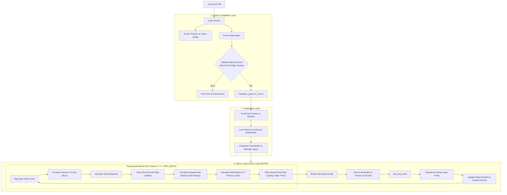

# Cub3D 🕹️ — 3D Raycasting Engine in C

<div align="center">

[](https://en.wikipedia.org/wiki/C_(programming_language))
[-FF6F00?style=for-the-badge&logo=opengl&logoColor=white)](https://github.com/codam-coding-college/MLX42)
[](LICENSE)
[](https://www.kernel.org/)

**A high-performance first-person 3D raycasting game engine built from scratch in C, inspired by the legendary *Wolfenstein 3D* (1992).**

[Features](#-key-features) • [Engine Architecture](#-engine-architecture) • [Mathematical Foundation](#-mathematical-foundation) • [Controls](#-controls--interactivity) • [Demos](#-gameplay--demos) • [Installation](#-installation--quickstart)

</div>

---

## 📖 Overview

**cub3D** is a dynamic 3D graphic rendering engine designed and developed in **C** using **MLX42** (a modern cross-platform graphics library based on GLFW and OpenGL). 

Rather than relying on 3D hardware polygon rendering, the engine translates a 2D planar map into an immersive pseudo-3D perspective in real time using the **Digital Differential Analysis (DDA)** raycasting technique. The project features directional texturing, dynamic real-time minimap rendering, mouse look controls with vertical pitch, collision detection, and custom scene parsing with strict map enclosure validation.

> [!TIP]
> **Why Raycasting?** Before GPU-accelerated 3D graphics became standard, raycasting allowed games like *Wolfenstein 3D* to render interactive 3D worlds on computationally limited CPUs with strict $\mathcal{O}(W)$ rendering complexity relative to screen width.

---

## 🎥 Gameplay & Demos

Check out the gameplay and raycaster showcase on YouTube:

<div align="center">

| Demo Showcase #1 | Demo Showcase #2 |
| :---: | :---: |
| [](https://youtu.be/Uo-BsljttwI) | [](https://youtu.be/oINDRLNVWC0) |
| *Smooth navigation, mouse camera rotation, and wall collision* | *Custom maps, vertical pitch inspection, and animated texture handling* |

</div>

---

## ✨ Key Features

- ⚡ **Ultra-Fast DDA Raycaster:** High-efficiency ray-grid intersection calculation running at steady 60+ FPS.
- 📐 **Fisheye Distortion Elimination:** Perpendicular wall distance projection ensuring rectilinear, undistorted surfaces.
- 🧭 **Directional Texture Mapping:** Automatic texture orientation matching wall normal vectors (North, South, East, West).
- 🖱️ **Full 2-DOF Camera Control:** Smooth horizontal yaw (arrow keys or mouse look) plus vertical pitch tilt (looking up/down).
- 🗺️ **Real-Time Minimap Overlay:** Toggleable HUD radar projecting player orientation and surrounding maze geometry.
- 🛡️ **Defensive Scene Parser (`.cub`):** Strict lexical verification, RGB color boundary checks, texture accessibility checks, and enclosed wall validation using flood-fill algorithms.
- 🧹 **Robust Memory Architecture:** Leak-free memory management validated under Valgrind, with clean resource deallocation on system signals and termination hooks.

---

## 🏗️ Engine Architecture

The engine is decoupled into four modular pipelines: **Parser**, **Initialization**, **Raycast Core**, and **Game Loop / Rendering**.



---

## 🧮 Mathematical Foundation

The core visual fidelity of **cub3D** is grounded in linear algebra, trigonometry, and analytical geometry.

### 1. Camera Plane & Field of View (FOV)

The player's viewpoint is defined by two vectors:
- Direction Vector: $\vec{D} = (d_x, d_y)$
- Camera Plane Vector: $\vec{P} = (p_x, p_y)$ (perpendicular to $\vec{D}$)

The Field of View ($FOV$) corresponds to the ratio between the length of the camera plane and the direction vector:
$$\text{FOV} = 2 \cdot \arctan\left(\frac{|\vec{P}|}{|\vec{D}|}\right) \approx 2 \cdot \arctan(0.66) \approx 66.8^\circ$$

For each horizontal screen pixel $x \in [0, W - 1]$, a scalar camera coordinate $camera_x \in [-1, 1]$ determines the current ray direction vector $\vec{R}$:
$$camera_x = \frac{2x}{W} - 1$$
$$\vec{R} = \vec{D} + \vec{P} \cdot camera_x = (d_x + p_x \cdot camera_x, \; d_y + p_y \cdot camera_x)$$

---

### 2. DDA (Digital Differential Analysis) & Delta Distances

To detect wall intersections on a discrete 2D grid without continuous ray marching steps, we calculate the distance the ray must travel to advance 1 full unit in $X$ or $Y$:

$$\Delta dist_x = \left|\frac{1}{R_x}\right|, \qquad \Delta dist_y = \left|\frac{1}{R_y}\right|$$

```
               Y-Grid Line
                   |   / Ray
                   |  /
    ---------------+ / ------------------
                   |/  <-- Wall hit detected!
    ---------------+---------------------
                   |
```

In each step, the algorithm chooses the shortest path between $sideDist_x$ and $sideDist_y$, advancing by exactly 1 grid square:
$$\text{if } sideDist_x < sideDist_y \implies \begin{cases} sideDist_x \mathrel{+}= \Delta dist_x \\ map_x \mathrel{+}= step_x \\ side = 0 \end{cases}$$
$$\text{else} \implies \begin{cases} sideDist_y \mathrel{+}= \Delta dist_y \\ map_y \mathrel{+}= step_y \\ side = 1 \end{cases}$$

---

### 3. Fisheye Correction (Perpendicular Distance)

Using Euclidean distance causes the **fisheye effect** because rays fired at the periphery of the screen travel further than rays fired directly forward, making flat walls appear curved. 

Instead, cub3D computes the **perpendicular distance** ($dist_\perp$) from the wall collision to the camera plane:

$$dist_\perp = \begin{cases} 
sideDist_x - \Delta dist_x & \text{if hit on X-axis wall } (side = 0) \\
sideDist_y - \Delta dist_y & \text{if hit on Y-axis wall } (side = 1)
\end{cases}$$

The projected wall height on screen is inversely proportional to $dist_\perp$:
$$lineHeight = \frac{WIN\_HEIGHT}{dist_\perp}$$

---

### 4. 2D Camera Rotation Matrix (Yaw)

When turning left or right by an angle $\theta$, both the direction vector $\vec{D}$ and the camera plane vector $\vec{P}$ undergo a 2D Euclidean rotation:

$$\begin{bmatrix} x' \\ y' \end{bmatrix} = \begin{bmatrix} \cos(\theta) & -\sin(\theta) \\ \sin(\theta) & \cos(\theta) \end{bmatrix} \begin{bmatrix} x \\ y \end{bmatrix}$$

$$\vec{D}' = (d_x \cos\theta - d_y \sin\theta, \; d_x \sin\theta + d_y \cos\theta)$$
$$\vec{P}' = (p_x \cos\theta - p_y \sin\theta, \; p_x \sin\theta + p_y \cos\theta)$$

---

### 5. Vertical Pitch & Horizon Offset (Pitch)

To allow the player to look up and down, the engine applies a vertical screen offset $move_y$:

$$start\_y = \frac{-lineHeight}{2} + \frac{WIN\_HEIGHT}{2} + move_y$$
$$end\_y = \frac{lineHeight}{2} + \frac{WIN\_HEIGHT}{2} + move_y$$

Clamping $|move_y| \le \frac{WIN\_HEIGHT}{2}$ prevents rendering inversion artifacts while delivering full 2.5D visual freedom.

---

### 6. UV Texture Mapping

To map 2D textures onto 3D walls:
1. Compute exact fractional hit position on wall: 
   $$wallX = \begin{cases} pos_y + dist_\perp \cdot R_y & (side = 0) \\ pos_x + dist_\perp \cdot R_x & (side = 1) \end{cases}$$
   $$wallX \leftarrow wallX - \lfloor wallX \rfloor \in [0.0, 1.0)$$
2. Compute horizontal texture coordinate:
   $$tex_x = \lfloor wallX \cdot texture\_width \rfloor$$
3. Interpolate vertical coordinate $tex_y$ for every screen pixel between $start\_y$ and $end\_y$:
   $$tex_y = \left\lfloor \frac{y - start\_y}{lineHeight} \cdot texture\_height \right\rfloor$$

---

## 🎮 Controls & Interactivity

| Key / Action | Function | Technical Description |
| :--- | :--- | :--- |
| <kbd>W</kbd> | Move Forward | Increments player position along $\vec{D}$ with collision checks |
| <kbd>S</kbd> | Move Backward | Decrements player position along $\vec{D}$ with collision checks |
| <kbd>A</kbd> | Strafe Left | Translates position perpendicularly along $( -d_y, d_x )$ |
| <kbd>D</kbd> | Strafe Right | Translates position perpendicularly along $( d_y, -d_x )$ |
| <kbd>←</kbd> / <kbd>→</kbd> | Rotate Left / Right | Rotates direction and camera plane vectors using rotation matrix |
| <kbd>↑</kbd> / <kbd>↓</kbd> | Look Up / Down | Modifies vertical horizon offset ($move_y$) |
| <kbd>C</kbd> | Toggle Mouse Look | Locks/unlocks mouse cursor for free-look rotation |
| <kbd>M</kbd> | Toggle Minimap | Shows/hides real-time 2D radar overlay |
| <kbd>ESC</kbd> | Exit Program | Gracefully frees all textures, buffers, and terminates MLX42 |

---

## 🗺️ Scene File Format (`.cub`)

The scene configuration file defines asset paths, color palettes, and map layout:

```ini
NO ./textures/north_texture.png
SO ./textures/south_texture.png
WE ./textures/west_texture.png
EA ./textures/east_texture.png

F 220,100,0       # Floor RGB (0 - 255)
C 225,30,0        # Ceiling RGB (0 - 255)

1111111111111111111111111
1000000000110000000000001
1011000001110000000000001
1001000000000000000000001
1111011111111101110000001
1111011111111101110101001
1100000011010101110000001
1000000000000000110000001
1000000000000000110101001
1100000111010101111101111
11110111 11010110111101111
11111111 11111111111111111
```

<details>
<summary><b>🔍 Strict Map Validation Rules (Click to expand)</b></summary>

- **Component Identification:** Requires exactly one instance of `NO`, `SO`, `WE`, `EA`, `F`, and `C`.
- **Character Whitelist:** Maps permit only `'0'` (empty space), `'1'` (wall), and `'N'`, `'S'`, `'E'`, `'W'` (player spawn orientation).
- **Spawn Constraint:** Exactly one player spawn location allowed across the entire map.
- **Enclosure Guarantee:** Map must be completely bounded by walls (`'1'`). Spaces (`' '`) outside are handled by a flood-fill algorithm ensuring no open leaks exist to void space.
</details>

---

## 🚀 Installation & Quickstart

### Prerequisites

Ensure you have CMake, a modern C compiler (`clang` or `gcc`), and GLFW installed:

```bash
# Ubuntu / Debian
sudo apt-get update
sudo apt-get install -y build-essential cmake libglfw3-dev libglfw3

# macOS (Homebrew)
brew install cmake glfw
```

### Build & Run

```bash
# 1. Clone repository
git clone https://github.com/SherlockPE/Cube-3D.git
cd Cube-3D

# 2. Compile binary
make

# 3. Launch with any included scene
./cub3D scenes/scene_1.cub
```

<details>
<summary><b>🛠️ Available Make Targets</b></summary>

- `make` — Compiles libraries (`libft`, `MLX42`) and generates `./cub3D`.
- `make bonus` — Builds with extended features (mouse view, minimap, pitch).
- `make clean` — Removes compiled object files.
- `make fclean` — Removes objects, build caches, and the binary.
- `make re` — Clean rebuild from scratch.
</details>

---

## 👥 Authors & Acknowledgments

Developed with ❤️ at **42 Madrid**:

- **Fabricio López Reyes** ([@SherlockPE](https://github.com/SherlockPE))
- **Alejandro Bartolomé Blanco** ([@Albartol](https://github.com/albartol))

*Special thanks to the [42 Network](https://www.42network.org/) and the [MLX42 Team](https://github.com/codam-coding-college/MLX42) for providing the graphics framework.*